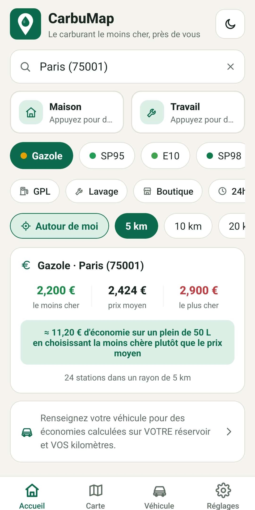
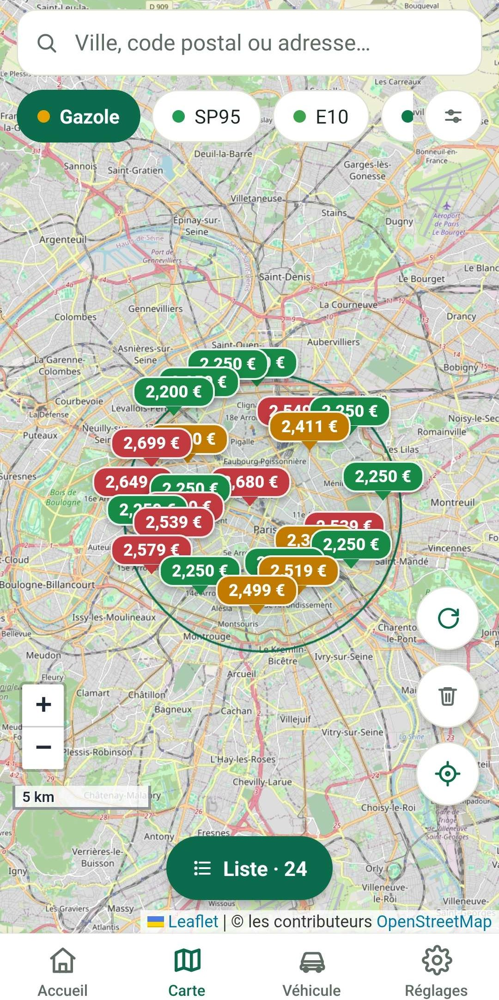
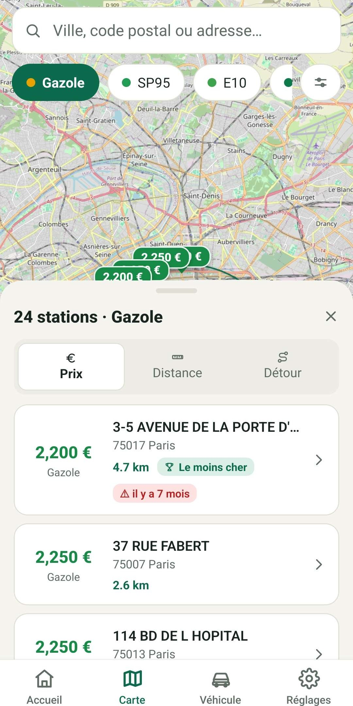
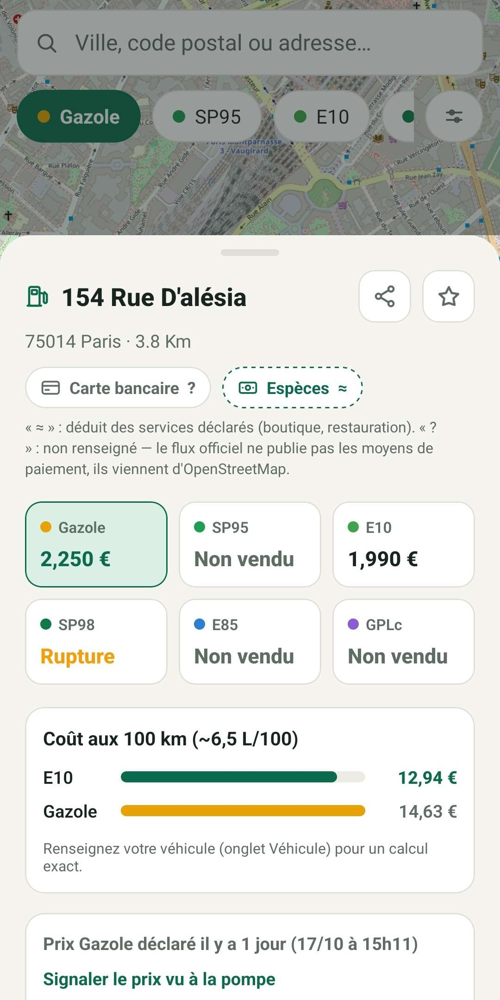

<div align="center">

# ⛽ CarbuMap — Application Android (APK)

### Le carburant le moins cher, en temps réel près de chez vous

[](#)
[](#)
[](#)
[](#)

<br/>

**CarbuMap** est votre copilote pour faire de réelles économies à chaque plein. L'application compare les stations-service autour de vous, calcule vos gains nets et affiche en direct les disponibilités et ruptures de carburants.

[⬇️ **Télécharger l'APK CarbuMap (Dernière version)**](#-téléchargement--installation-de-lapk) &nbsp;•&nbsp; [✨ Découvrir les fonctionnalités](#-aperçu-de-lapplication) &nbsp;•&nbsp; [📖 Guide d'installation](#-guide-dinstallation-pas-à-pas)

</div>

---

## 📸 Aperçu de l'application

|                             📱 Accueil & Économies                              |                             🗺️ Carte Interactive                             |                       📋 Liste & Tri Intelligent                       |                       ⛽ Fiche Station & Ruptures                        |
| :-----------------------------------------------------------------------------: | :--------------------------------------------------------------------------: | :--------------------------------------------------------------------: | :----------------------------------------------------------------------: |
|          |           |      |     |
| _Statistiques de prix (min, moyen, max) & calcul des économies sur votre plein_ | _Pastilles de prix colorées en temps réel (vert = économique, rouge = cher)_ | _Tri par prix au litre, distance ou calcul de rentabilité avec détour_ | _Tous les carburants, alertes de rupture, coût aux 100 km & signalement_ |

---

## 🌟 Fonctionnalités clés

### 💶 Économisez à chaque plein

- **Statistiques en direct** : Visualisez d'un coup d'œil le prix minimum, moyen et maximum dans votre zone géographique.
- **Calcul d'économie personnalisé** : Estimez immédiatement vos économies sur un plein complet (ex: 50 L) par rapport au prix moyen.
- **Profil véhicule** : Renseignez votre volume de réservoir et votre consommation pour un calcul sur-mesure.

### 🗺️ Carte dynamique avec pastilles de prix

- **Visualisation instantanée** : Marqueurs colorés directement sur la carte :
  - 🟢 **Vert** : Stations les moins chères (les meilleurs plans).
  - 🟡 **Orange** : Prix intermédiaires.
  - 🔴 **Rouge** : Stations les plus chères à éviter.
- **Rayon réglable** : Ajustez votre zone de recherche en un tap (5 km, 10 km, 20 km ou 50 km).
- **Raccourcis pratiques** : Accès rapide « Maison », « Travail » ou géolocalisation « Autour de moi ».

### 🔀 Tri intelligent & rentabilité du détour

- **Tri par Prix** : La station la moins chère en tête de liste.
- **Tri par Distance** : La station la plus proche pour les urgences.
- **Tri « Prix + Détour »** : Calcule si cela vaut vraiment le coup de faire des kilomètres en plus en déduisant le carburant consommé pour le trajet aller-retour !

### ⛽ Fiche station complète & alerte rupture

- **Disponibilité des 6 carburants** : Gazole, SP95, SP98, E10, E85 et GPLc.
- **Alertes rupture en direct** : Visualisez instantanément les carburants en rupture de stock avant de vous déplacer.
- **Comparateur Coût aux 100 km** : Barres graphiques comparant le coût réel de chaque carburant pour 100 km parcourus.
- **Moyens de paiement & services** : Cartes bancaires, espèces, automate 24h/24, lavage, boutique, etc.
- **Prix participatifs** : Bouton « Signaler le prix vu à la pompe » pour actualiser les tarifs en temps réel si un écart est constaté.

### 📴 Mode hors-ligne & Respect de la vie privée

- **Consultable sans réseau** : Les dernières zones recherchées restent accessibles même dans les parkings souterrains ou en zone blanche.
- **Confidentialité totale** : Aucun compte requis, aucune collecte de données personnelles, zéro publicité.

---

## 📥 Téléchargement & Installation de l'APK

### 🔗 Fichier APK

> **Version actuelle** : `v1.2.0`  
> **Système requis** : Android 8.0 (Oreo) ou version ultérieure  
> **Taille** : ~35 Mo

👉 **[Télécharger CarbuMap APK (Dernière version)](https://github.com/votre-nom-utilisateur/carbumap/releases/latest)** _(ou récupérez le fichier `.apk` dans la section Releases)_

---

### 📲 Guide d'installation pas-à-pas

L'installation par fichier APK sur Android est simple, rapide et sécurisée :

```text
1. Télécharger l'APK  ➡️  2. Ouvrir le fichier  ➡️  3. Autoriser la source  ➡️  4. Installer & Économiser !
```

1. **Téléchargez** le fichier `CarbuMap.apk` directement sur votre smartphone depuis le lien ci-dessus.
2. Une fois le téléchargement terminé, appuyez sur la notification ou ouvrez votre application **Téléchargements / Fichiers**.
3. **Autorisez l'installation** si Android affiche le message d'avertissement de sécurité habituel :
   - Appuyez sur **Paramètres**.
   - Cochez **« Autoriser cette source »** (pour votre navigateur ou gestionnaire de fichiers).
4. Appuyez sur **Installer**.
5. Ouvrez **CarbuMap** et commencez à économiser sur votre prochain plein ! 🎉

---

## 📊 Origine des données

Les prix et informations proviennent de la **base de données officielle du Ministère de l'Économie et des Finances** (_data.economie.gouv.fr_).  
Le flux instantané est actualisé en continu toutes les 10 minutes par les stations-service françaises en application de la réglementation gouvernementale.

---

## ❓ Foire Aux Questions (FAQ)

<details>
<summary><b>Pourquoi l'application est-elle distribuée sous forme d'APK ?</b></summary>
<p>
L'APK permet une installation directe, sans passer par un store d'applications tiers, sans création de compte Google obligatoire et avec un accès immédiat aux toutes dernières fonctionnalités.
</p>
</details>

<details>
<summary><b>Pourquoi Android affiche-t-il « Source inconnue » lors de l'installation ?</b></summary>
<p>
C'est la procédure de sécurité standard d'Android pour toute application installée en dehors du Google Play Store officiel. Le fichier APK CarbuMap ne contient aucun traceur, aucun adware ni malware.
</p>
</details>

<details>
<summary><b>L'application fonctionne-t-elle sans activer la localisation GPS ?</b></summary>
<p>
Oui ! La géolocalisation GPS est 100% facultative. Vous pouvez rechercher n'importe quelle station simplement en tapant le nom d'une ville, un code postal ou une adresse précise dans la barre de recherche.
</p>
</details>

<details>
<summary><b>L'application est-elle payante ou contient-elle des abonnements ?</b></summary>
<p>
Non. CarbuMap est totalement gratuite, sans abonnement, sans achat intégré et garantie sans publicité.
</p>
</details>

---

<div align="center">

**CarbuMap** — Développé pour aider chaque automobiliste à payer son carburant au juste prix.

</div>
